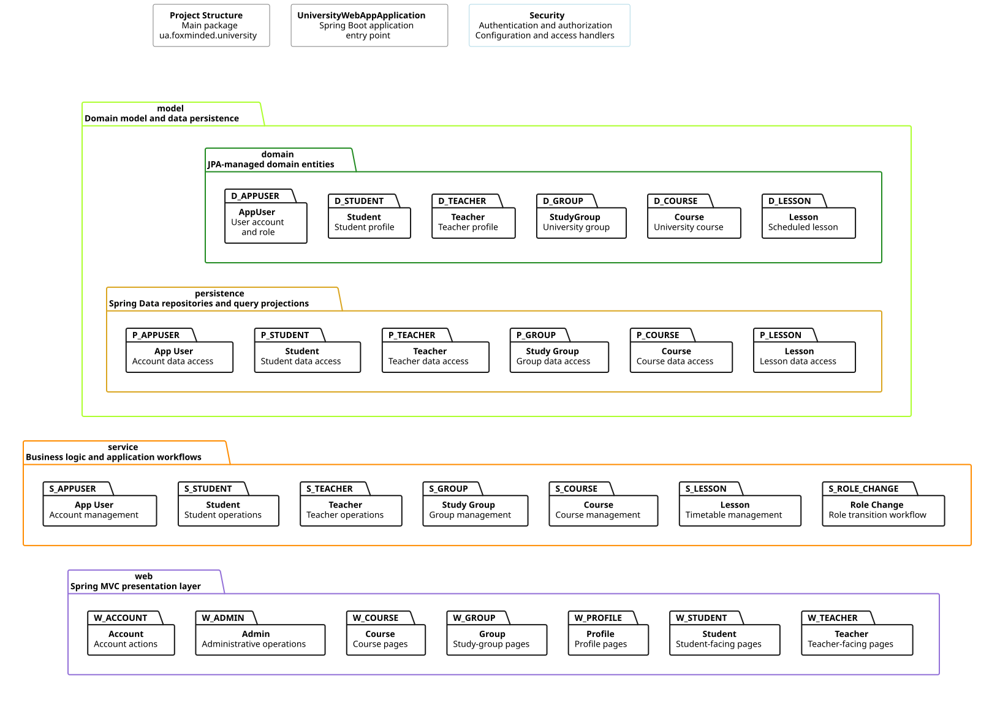
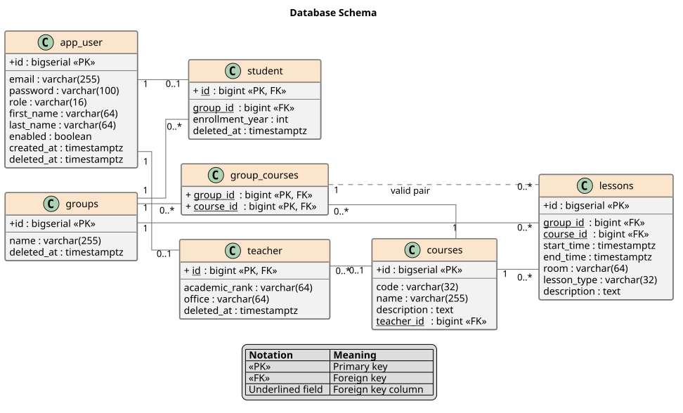

# University Timetable Management System

### GitHub Actions · Continuous Integration · Docker Publishing · Project Versioning · Python Scripts

[](https://github.com/Yurii-Kor/university-web-app/actions/workflows/university-web-app-ci.yml)
[](https://github.com/Yurii-Kor/university-web-app/actions/workflows/publish-docker.yml)
[](https://github.com/Yurii-Kor/university-web-app/actions/workflows/update-project-version.yml)


### Java 21 · Spring Boot 3.5.5 · Spring MVC · Spring Security · Thymeleaf · Spring Data JPA · PostgreSQL · HTML5 · CSS3


A role-based university timetable and academic management web application built with [Spring Boot](https://www.baeldung.com/spring-boot-start), Spring MVC, Thymeleaf, Spring Data JPA, and PostgreSQL.

The application provides role-specific workflows for students, teachers, and administrators. It supports account and profile management, study groups, courses, scheduled lessons, weekly and daily timetable views, PDF schedule export, user role transitions, and soft deletion with restoration of supported records.

Authentication is implemented through Spring Security [form login](https://www.baeldung.com/spring-security-login). Authorization is enforced through both HTTP security configuration and [method-level security](https://www.baeldung.com/spring-security-method-security), while [Spring Security integration with Thymeleaf](https://www.baeldung.com/spring-security-thymeleaf) controls role-dependent navigation, available actions, and page content.

The project follows a layered package structure that separates the domain model, Spring Data JPA persistence, application services, web presentation, and security concerns. Its test suite combines unit and integration testing with focused Spring MVC tests using [`@WebMvcTest`](https://www.baeldung.com/spring-boot-testing#unit-testing-with-webmvctest).

---

<!--
User-story source of truth:
src/main/resources/content/user-stories/
-->

<details>
<summary><h2>User Stories</h2></summary>

The application is organized around eight role-aware functional areas. Expand an area below to see its user stories and role-specific behavior.

<details>
<summary><strong>1. Profile</strong> — personal account and profile management</summary>

### Common

As an authenticated user, I can:

- view my own account information;
- update my email, first name, and last name;
- change my account password.

### Student

As a **Student**, I can also:

- view my enrollment year;
- view my assigned study group.

### Teacher

As a **Teacher**, I can also:

- view my academic rank;
- view my office information.

### Admin

As an **Admin**, I use the common profile capabilities for my account.

</details>

<details>
<summary><strong>2. Courses</strong> — role-specific course browsing and management</summary>

### Common

As an authenticated user, I can:

- browse the course cards available to my account;
- show or hide course descriptions.

### Student

As a **Student**, I can:

- view the courses assigned to my study group.

### Teacher

As a **Teacher**, I can:

- view the courses assigned to me;
- update the description of a course I teach.

### Admin

As an **Admin**, I can:

- view all university courses;
- create a new course;
- update a course description;
- update a course code and name;
- change the teacher assigned to a course;
- delete a course;
- manage the study groups assigned to a course.

</details>

<details>
<summary><strong>3. Study Groups</strong> — group information and administration</summary>

### Student

As a **Student**, I can:

- view my assigned study group;
- view the number of students in my group.

### Teacher

As a **Teacher**, I can:

- view the study groups where I teach;
- view the number of students in each study group;
- view the number of courses associated with each study group.

### Admin

As an **Admin**, I can:

- view all active study groups;
- create a new study group;
- update a study group's name;
- soft delete an empty study group.

A study group with assigned students cannot be deleted.

</details>

<details>
<summary><strong>4. Students</strong> — role-aware student directory</summary>

### Student

As a **Student**, I can:

- view the other students in my study group;
- view each group member's name and email.

### Teacher

As a **Teacher**, I can:

- view students from study groups assigned to courses I teach;
- view each student's name, email, and study group.

### Admin

As an **Admin**, I can:

- view all enabled student accounts;
- browse the student list using pagination;
- create a new student account;
- change a student's assigned study group;
- update a student's enrollment year.

Student deletion is intentionally not available from the **Students** page. Sensitive account operations are handled in **Account Management**.

</details>

<details>
<summary><strong>5. Teachers</strong> — role-aware teacher directory</summary>

### Student

As a **Student**, I can:

- view teachers assigned to courses of my study group;
- view each teacher's name, email, academic rank, and office.

### Teacher

As a **Teacher**, I can:

- view other active teachers as colleagues;
- view each colleague's name, email, academic rank, and office.

### Admin

As an **Admin**, I can:

- view all active teachers;
- browse the teacher list using pagination;
- create a new teacher account;
- update a teacher's academic rank;
- update a teacher's office.

Teacher deletion is intentionally not available from the **Teachers** page. Sensitive account operations are handled in **Account Management**.

</details>

<details>
<summary><strong>6. Schedule</strong> — weekly and daily timetable management</summary>

### Common

As a **Student** or **Teacher**, I can:

- view the schedule for a selected week;
- open a specific day from the weekly schedule;
- view the schedule for a selected day;
- navigate to previous and next weeks;
- navigate to previous and next days;
- return to the current week or day;
- download the selected weekly schedule as a PDF file.

### Student

As a **Student**, I can:

- view lessons assigned to my study group;
- view the teacher assigned to each lesson.

The student schedule is read-only.

### Teacher

As a **Teacher**, I can:

- view lessons assigned to me;
- view the study group assigned to each lesson;
- create a lesson for a course I teach;
- select only study groups assigned to the selected course;
- review my existing lessons for the selected day before creating or updating a lesson;
- review the selected study group's existing lessons for the selected day;
- update an existing lesson;
- delete an existing lesson.

When creating or updating a lesson, the application prevents scheduling conflicts involving the **teacher**, **study group**, and **room**.

During an update, the lesson currently being edited is excluded from conflict checks against itself.

The course and study group of an existing lesson remain fixed during update, while the date, time, room, lesson type, and description can be changed.

### Admin

The **Schedule** area is not available to administrators.

</details>

<details>
<summary><strong>7. Admins</strong> — administrator account management</summary>

The **Admins** area is available only to administrators.

As an **Admin**, I can:

- view all administrator accounts, including my own;
- identify my currently signed-in administrator account in the list;
- create a new administrator account;
- block an active administrator account;
- enable a blocked administrator account;
- delete another administrator account.

An administrator cannot delete their own account.

</details>

<details>
<summary><strong>8. Account Management</strong> — sensitive account lifecycle and role conversion</summary>

The **Account Management** area is available only to administrators and contains separate **Students** and **Teachers** views.

As an **Admin**, I can:

- browse student and teacher accounts using pagination;
- view account status and role-specific profile information;
- enable blocked accounts;
- disable active accounts;
- soft delete student and teacher accounts;
- convert a Student account to a Teacher account;
- convert a Teacher account to a Student account.

### Role conversion

Role conversion reuses the existing account instead of creating an unrelated new account.

Role-specific profile data is preserved through soft deletion and can later be reused when it remains valid.

Before conversion, the frontend requests a restoration assessment from the backend.

If a previous target-role profile can be restored as-is:

- its existing data can be reused;
- the administrator does not need to enter the target-role profile data again.

If the stored target-role profile cannot be reused:

- the administrator is asked to provide the required replacement data before conversion.

For **Student → Teacher**, the target profile requires:

- academic rank;
- office.

For **Teacher → Student**, the target profile requires:

- study group;
- enrollment year.

For example, a previously assigned study group may no longer be available. In that case, new student profile data must be provided before the conversion can be completed.

</details>

</details>

---

<details open>
<summary><h2>Project Structure</h2></summary>

The application source code is organized under the main package
[`src/main/java/ua/foxminded/university`](src/main/java/ua/foxminded/university).

`UniversityWebAppApplication` is the Spring Boot entry point. Security-related configuration, authentication services, password policies, and access handlers are grouped separately in the `security` package as a cross-cutting application concern.

The project follows a layered structure:

1. **Model layer**
   - **`domain`** — contains the JPA-managed entities and enums that represent the university domain: users, students, teachers, study groups, courses, and lessons.
   - **`persistence`** — contains Spring Data JPA repositories and their query projections, grouped by the corresponding domain entity.

2. **Service layer**
   - Contains the application business logic and use-case orchestration.
   - Services are grouped by functional area, together with their related DTOs and exceptions.
   - The separate `rolechange` package implements the workflow for transitioning users between student and teacher roles.

3. **Web layer**
   - Contains Spring MVC controllers, request binding, exception handling, and web configuration.
   - Web components are grouped by user-facing areas such as accounts, administration, courses, groups, lessons, profiles, students, teachers, and the public home page.



Supporting DTOs, projections, validators, mappers, configuration classes, and exceptions are omitted from the diagram where necessary to keep the overall structure readable.

[View the PlantUML source](docs/architecture/application-structure.puml)

</details>

---

<details open>
<summary><h2>Database</h2></summary>

The application uses PostgreSQL as its relational database. Database connectivity, JPA integration, and transaction infrastructure are configured through Spring Boot.

The database layer is built around the following tools and responsibilities:

- **[Flyway migrations](src/main/resources/db/migration)** — create the database schema, define constraints and indexes, and populate the development environment with reproducible sample data.
- **[Hibernate-managed entities](src/main/java/ua/foxminded/university/model/domain)** — map the application domain model to relational tables through Jakarta Persistence annotations.
- **[Spring Data JPA repositories](src/main/java/ua/foxminded/university/model/persistence)** — provide repository interfaces, derived queries, JPQL queries, and query projections for database access.
- **[Service-layer transactions](src/main/java/ua/foxminded/university/service)** — combine repository operations into transactional business workflows.
- **PostgreSQL `pgcrypto`** — hashes generated development passwords with bcrypt-compatible `crypt()` and `gen_salt()` functions.

### Database Schema

The schema models application accounts, role-specific student and teacher profiles, study groups, courses, group-course assignments, and scheduled lessons.



[View the PlantUML source](docs/architecture/database-schema.puml)

### Generated Development Data

The seed migration creates a repeatable development dataset for running and demonstrating the application locally. Insert operations use conflict handling where appropriate, allowing the migration logic to avoid duplicating existing records.

| Entity / table | Generated records | Description |
|---|---:|---|
| `app_user` | 108 | Creates 100 student accounts, 6 teacher accounts, and 2 administrator accounts. One account of each role is disabled for authorization and account-state testing. |
| `student` | 100 | Creates one student profile for every student account and distributes the students across the five study groups. The enrollment year is set to the current year. |
| `teacher` | 6 | Creates one teacher profile for every teacher account, with a generated office and an academic rank selected from `LECTURER`, `SENIOR_LECTURER`, or `PROFESSOR`. |
| `groups` | 5 | Creates the study groups `CS-101`, `CS-102`, `CS-103`, `CS-104`, and `CS-105`. |
| `courses` | 10 | Creates courses covering Java, databases, networking, operating systems, Spring Boot, frontend development, machine learning, computer graphics, and application security. |
| `group_courses` | 15 | Assigns three courses to each study group and defines the valid group-course combinations used by the timetable. |
| `lessons` | 0 | The base seed migration does not create scheduled lessons; they can be added through the application workflows or dedicated test data. |

Generated accounts follow predictable development-only credential patterns:

| Role | Email pattern | Password pattern |
|---|---|---|
| Teacher | `teacherN@mail.com` | `Tch-N!dev` |
| Student | `studentN@mail.com` | `Std-N!dev` |
| Administrator | `adminN@mail.com` | `Adm-N!dev` |

> [!IMPORTANT]
> These credentials are intended only for local development, demonstrations, and automated tests. They must not be used in a production environment.

</details>

---

<details open>
<summary><h2>🐳 Dockerization</h2></summary>

The application is containerized with Docker and published as a versioned image to Docker Hub.

- **Project versioning** — the [`update-project-version.yml`](.github/workflows/update-project-version.yml) workflow updates the Maven project version in `pom.xml` on the `dev` branch.
- **Release publishing** — after the completed changes are merged into `main`, the [`publish-docker.yml`](.github/workflows/publish-docker.yml) workflow is started manually. It creates a Git tag from the current Maven version and publishes the Docker image with both the version-specific tag and `latest`.
- **Container image** — published in the [University Web App Docker Hub repository](https://hub.docker.com/repository/docker/yuriikorolkov/university-web-app/general).

[](https://hub.docker.com/repository/docker/yuriikorolkov/university-web-app/general)

Latest image:

```bash
docker pull yuriikorolkov/university-web-app:latest
```

</details>